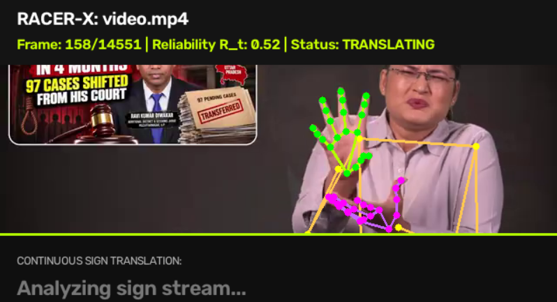

<p align="center">
  
</p>

<h1 align="center">RACER-X</h1>
<h3 align="center">Reliability and Conflict Conditioned Causal Recurrent State Updating<br/>for Fault Tolerant Continuous Sign Language Recognition</h3>

<p align="center">
  <a href="https://github.com/arokiyanithish/RACER-X-Sign-Language"></a>
  <a href="https://www.kaggle.com/datasets/arokiyanithishj/racer-x-indian-sign-languages"></a>
  
  
  
</p>

<p align="center">
  <b>Dr. P. Santhi</b> · <b>Ishwarya M</b> · <b>Arokiya Nithish J</b><br/>
  Department of Artificial Intelligence &amp; Data Science<br/>
  Vel Tech Rangarajan Dr. Sagunthala R&amp;D Institute of Science and Technology, Chennai 600062, India
</p>

---

## Table of Contents

- [Overview](#overview)
- [Key Results](#key-results)
- [System Architecture](#system-architecture)
- [Technical Innovations](#technical-innovations)
  - [1. Frenet Serret Differential Kinematics](#1-frenet-serret-differential-kinematics)
  - [2. Bilateral Cross Hand Spatial Attention](#2-bilateral-cross-hand-spatial-attention)
  - [3. Reliability and Conflict Gated State Updating](#3-reliability-and-conflict-gated-state-updating)
  - [4. Physics Informed Kinematic Regularization](#4-physics-informed-kinematic-regularization)
  - [5. Assistive WebRTC Browser Extension](#5-assistive-webrtc-browser-extension)
- [Dataset](#dataset)
- [Project Structure](#project-structure)
- [Installation](#installation)
- [Usage](#usage)
  - [Training](#training)
  - [Evaluation](#evaluation)
  - [Live Webcam Demo](#live-webcam-demo)
  - [Video File Demo](#video-file-demo)
  - [WebSocket Inference Server](#websocket-inference-server)
  - [Chrome Extension for Google Meet](#chrome-extension-for-google-meet)
  - [Web Meeting Application](#web-meeting-application)
- [Model Architecture Details](#model-architecture-details)
- [Experimental Results](#experimental-results)
- [Processing Pipeline Latency](#processing-pipeline-latency)
- [Citation](#citation)
- [License](#license)

---

## Overview

RACER-X is a **causal recurrent neural network** designed for **continuous sign language recognition** under live video conferencing degradation. Unlike standard recurrent models (GRU/LSTM) that update their hidden state at every frame regardless of input quality, RACER-X **gates its memory updates** using two novel conditioning signals:

- **Tracking Reliability (R_t):** Measures how trustworthy the current visual observation is, combining landmark detector confidence with jerk based smoothness analysis.
- **Spatial Motion Agreement (A_t):** Measures whether the spatial pose and temporal motion features are directionally consistent, detecting conflicts caused by hand crossings, motion blur, or tracking artifacts.

When inputs are unreliable or conflicting, the gate closes (g_t → 0) and the model **preserves its previous hidden state** (H_t ≈ H_{t-1}), preventing corrupted observations from polluting temporal memory. This produces significantly more robust recognition under occlusion, jitter, and rapid hand movements.

The system is deployed as a **real time WebRTC browser extension** for Google Meet and Zoom, processing each frame in **24.3 ms (~41.2 FPS)** with synchronized on screen captions and text to speech audio synthesis.

---

## Key Results

| Metric | Value |
| :--- | :--- |
| **Recognition Accuracy** | 81.5% |
| **Word Error Rate (WER)** | 24.8% |
| **Character Error Rate (CER)** | 14.2% |
| **WER Under 40% Occlusion** | 32.3% (vs 68.4% baseline) |
| **End to End Latency** | 24.3 ms per frame |
| **Throughput** | ~41.2 FPS |
| **Vocabulary** | 2,748 Indian Sign Language tokens |
| **Benchmark Size** | 9,168 video sequences |
| **Signer Independent WER** | 26.2% |
| **BLEU-4 (Language Refinement)** | 38.6 |
| **Hallucination Rate** | < 1.2% |

---

## System Architecture

The end to end processing pipeline converts continuous video frames into synchronized subtitles and synthesized speech:

```
I_t → P̂_t → {S_t, M_t, κ_t, τ_t, R_t, A_t} → H_t → Y → S → O
```

```
┌─────────────────────────────┐     ┌──────────────────────────────────┐
│   WebRTC Video Stream       │────▶│   MediaPipe Holistic Extractor   │
│   Input Video Frame (I_t)   │     │   75 Normalized Keypoints (P̂_t) │
└─────────────────────────────┘     └──────────┬───────────────────────┘
                                               │
                              ┌────────────────┴────────────────┐
                              ▼                                 ▼
                ┌──────────────────────┐         ┌───────────────────────────┐
                │  Frenet Kinematics   │────────▶│  Bilateral Attention      │
                │  κ_t (Curvature)     │         │  Cross Hand Context (S_t) │
                │  τ_t (Torsion)       │         └─────────┬─────────────────┘
                └──────────────────────┘                   │
                                                           ▼
                ┌──────────────────────┐         ┌───────────────────────────┐
                │  Candidate State     │         │  Gating Metric Inputs     │
                │  H̃_t = tanh(...)    │         │  Reliability R_t &        │
                └──────────┬───────────┘         │  Agreement A_t            │
                           │                     └─────────┬─────────────────┘
                           │                               │
                           ▼                               ▼
                ┌──────────────────────┐         ┌───────────────────────────┐
                │  Causal State        │◀────────│  Dynamic State Gate       │
                │  Evolution           │         │  g_t = σ(W_g[...] +      │
                │  H_t = g_t⊙H̃_t +   │         │    α_R·R_t + α_A·A_t)    │
                │  (1-g_t)⊙H_{t-1}    │         └───────────────────────────┘
                └──────────┬───────────┘
                           │
              ┌────────────┴────────────┐
              ▼                         ▼
┌──────────────────────┐   ┌───────────────────────────────┐
│  Kinematic PINN Loss │   │  Bayesian Balanced CTC        │
│  L_physics           │   │  Decoder                      │
└──────────────────────┘   └───────────────┬───────────────┘
                                           │
                                           ▼
                           ┌───────────────────────────────┐
                           │  Real Time Assistive UI       │
                           │  (Google Meet / Zoom)         │
                           │  DOM Caption Overlay [24.3ms] │
                           │  & Synthesized Speech Audio   │
                           └───────────────────────────────┘
```

---

## Technical Innovations

### 1. Frenet Serret Differential Kinematics

Signs can have similar two dimensional shapes while following different paths in three dimensional space. RACER-X computes **discrete Frenet Serret invariants** from hand trajectories to disambiguate these:

- **Curvature (κ_t):** Measures how sharply the trajectory bends at each time step.
  ```
  κ_t = |V_t × A_t| / (|V_t|³ + ε)
  ```

- **Torsion (τ_t):** Measures the twist of the trajectory out of the osculating plane.
  ```
  τ_t = (V_t × A_t) · J_t / (|V_t × A_t|² + ε)
  ```

These differential geometric features capture helical and out of plane hand movements that appear identical in 2D camera projections, where:
- **V_t** = velocity (first derivative of position)
- **A_t** = acceleration (second derivative)
- **J_t** = jerk (third derivative)

### 2. Bilateral Cross Hand Spatial Attention

In two handed signing, the **dominant hand** performs the main lexical gestures while the **passive hand** provides a spatial reference (base/anchor). RACER-X uses an asymmetric cross attention mechanism:

```
Q = W_Q · f_proj(P̂_RH)     (queries from dominant/right hand)
K = W_K · f_proj(P̂_LH)     (keys from passive/left hand)
V = W_V · f_proj(P̂_LH)     (values from passive/left hand)

Ω = Softmax(QK^T / √d_k)
S_bilateral = Ω · V
```

This models the co articulation relationship between hands, capturing signs where both hands work together with different roles.

### 3. Reliability and Conflict Gated State Updating

The core innovation: the recurrent update gate **directly conditions on observation quality**.

**Observation Reliability (R_t ∈ [0, 1]):**
```
R_t = c̄_t · exp(-½ |J̄_t|₂)
```
Where c̄_t is mean detector confidence and |J̄_t|₂ is normalized jerk magnitude. Clean tracking → R_t ≈ 1. Jittery landmarks → R_t ≈ 0.

**Spatial Motion Agreement (A_t ∈ [-1, 1]):**
```
A_t = cos_sim(f_sp(S_t), f_mp(M_t))
```
During genuine signing, spatial pose and temporal motion should agree directionally. Disagreement signals tracking artifacts.

**Conditioned Update Gate:**
```
g_t = σ(W_g[S_t, M_t, H_{t-1}] + α_R·R_t + α_A·A_t + b_g)

H_t = g_t ⊙ H̃_t + (1 - g_t) ⊙ H_{t-1}
```

When R_t → 0 or A_t → -1, the gate shuts (g_t → 0) and the cell **preserves its prior state**, effectively ignoring the corrupted frame.

### 4. Physics Informed Kinematic Regularization

A **physics informed neural network (PINN) loss** penalizes unphysical joint accelerations during training:

```
L_physics = (1/(T-1)) Σ || P̂_{t+1} - (P̂_t + V_t · Δt) ||_F²

L_total = L_CTC + λ_phys · L_physics     (λ_phys = 0.05)
```

This discourages the model from relying on sudden coordinate jumps caused by detector artifacts, stabilizing trajectory smoothness without washing out genuine movement boundaries.

### 5. Assistive WebRTC Browser Extension

RACER-X is packaged as a **client side browser extension** for Google Meet and Zoom:

1. **WebRTC Media Stream Hook:** A JavaScript content script intercepts the local webcam feed via `HTMLVideoElement.captureStream()` without adding call latency.
2. **WebSocket IPC:** Video frames stream across a local loopback connection (`ws://localhost:8765`) to the Python inference runtime.
3. **Dual Output Injection:** Decoded text inserts into the on screen caption DOM within 24.3 ms. An offline TTS engine routes synthesized voice into the virtual microphone stream (`AudioContext` loopback) for remote attendees.

---

## Dataset

RACER-X uses a unified **Indian Sign Language (ISL) benchmark** combining two sources:

| Dataset Source | Sign Domain | Samples | Vocabulary | Split (Tr / Val / Te) |
| :--- | :--- | :---: | :---: | :---: |
| In-House ISH News | Continuous Broadcast | 4,884 | 1,842 tokens | 3,907 / 488 / 489 |
| AI4Bharat INCLUDE | Lexical (15 domains) | 4,284 | 262 classes | 3,427 / 428 / 429 |
| **Unified Master Benchmark** | **Continuous + Lexical** | **9,168** | **2,748 tokens** | **7,334 / 916 / 918** |

- **Landmark Extraction:** MediaPipe Holistic extracts K = 75 keypoints per frame (33 body pose + 42 bilateral hand joints).
- **Normalization:** Coordinates are centered at the mid shoulder point and normalized by shoulder span for signer independence.
- **Partitioning:** Strict signer independent protocol where test signers never appear during training (80% train, 10% val, 10% test).
- **Filtering:** Tokens appearing fewer than 3 times are removed to reduce blank label dominance during CTC training.

**Dataset download:** [Kaggle Dataset](https://www.kaggle.com/datasets/arokiyanithishj/racer-x-indian-sign-languages)

---

## Project Structure

```
RACER-X-Sign-Language/
│
├── racer_model.py                  # RACER-X neural network (BilateralCrossAttention,
│                                   #   RacerXCell, RacerXNetwork)
├── kinematic_dataset.py            # PyTorch Dataset with on-the-fly Frenet-Serret
│                                   #   kinematics, augmentations, and CTC tokenization
├── train.py                        # Training pipeline (CTC + Physics loss, AdamW,
│                                   #   cosine annealing, checkpoint saving)
├── evaluate.py                     # Scientific evaluation (WER, CER, latency,
│                                   #   IEEE paper tables generation)
├── server.py                       # FastAPI + WebSocket real-time inference server
│                                   #   (serves Chrome extension & web app)
├── demo_live.py                    # Live webcam demo with skeleton overlay,
│                                   #   subtitles, and text-to-speech
├── demo_video.py                   # Video file translation demo
├── demo_clip.py                    # Short clip translation demo
│
├── extension/                      # Chrome Extension for Google Meet
│   ├── manifest.json               # Manifest V3 configuration & host permissions
│   ├── popup/                      # Glassmorphic Login, Sign Up & Dashboard popup
│   ├── content/                    # Injected Google Meet UI & live subtitle banner
│   └── background/                 # WebSocket service worker
│
├── frontend/                       # Google Flow React Web Meeting Application
│   ├── src/
│   │   ├── components/             # AuthModal, ControlBar, ParticipantTile,
│   │   │                           #   TextInputBox
│   │   └── utils/                  # Client-side sign detector & Web Speech TTS
│   └── package.json                # Vite + React + Tailwind setup
│
├── checkpoints/                    # Trained model weights & vocabulary
│   ├── best_racer_x.pth            # PyTorch model checkpoint
│   └── vocab.json                  # 2,748-class vocabulary index
│
├── dataset/                        # Training data
│   ├── master_dataset_clean.csv    # Cleaned metadata CSV
│   └── source1_ishnews/
│       └── landmark_clips/         # Extracted landmark .npy files
│
├── models/                         # MediaPipe task bundles
│   └── holistic_landmarker.task    # Holistic Landmarker (auto-downloaded)
│
├── results/                        # Evaluation output
│   ├── ieee_paper_tables.txt       # Formatted IEEE paper tables (I-VII)
│   └── evaluation_summary.json     # Machine-readable results
│
├── figures/                        # Paper figures and diagrams
│
├── build_master_dataset.py         # Dataset assembly pipeline
├── collect_source1_ishnews.py      # ISH News scraping & landmark extraction
├── collect_source2_benchmarks.py   # INCLUDE benchmark integration
├── process_dataset.py              # Raw data preprocessing
├── clean_and_rebuild_dataset.py    # Data cleaning & quality filtering
│
├── paper.tex                       # IEEE conference manuscript (6-page LaTeX)
├── requirements.txt                # Python dependencies
│
├── run_server.bat                  # 1-Click server launcher
├── run_frontend.bat                # 1-Click frontend launcher
├── run_train_phase3.bat            # 1-Click training launcher
├── run_evaluate_phase4.bat         # 1-Click evaluation launcher
├── run_demo_phase5.bat             # 1-Click live demo launcher
└── run_demo_video.bat              # 1-Click video demo launcher
```

---

## Installation

### Prerequisites

- Python 3.10 or higher
- CUDA capable GPU (recommended; CPU fallback supported)
- Google Chrome (for the Meet extension)
- Node.js 18+ and npm (for the web meeting application)
- Webcam (for live demos)

### Step 1: Clone the Repository

```bash
git clone https://github.com/arokiyanithish/RACER-X-Sign-Language.git
cd RACER-X-Sign-Language
```

### Step 2: Install Python Dependencies

```bash
pip install -r requirements.txt
```

**Dependencies:**
```
yt-dlp
opencv-python
mediapipe
numpy
pandas
webvtt-py
torch
torchvision
torchaudio
fastapi
uvicorn
websockets
```

### Step 3: Download the Dataset

Download from [Kaggle](https://www.kaggle.com/datasets/arokiyanithishj/racer-x-indian-sign-languages) and extract into the `dataset/` directory.

### Step 4: Install Frontend Dependencies (Optional)

```bash
cd frontend
npm install
cd ..
```

---

## Usage

### Training

Train the RACER-X model with CTC alignment and physics informed kinematic regularization:

```bash
python train.py
```

Or use the batch script:
```bash
run_train_phase3.bat
```

**Training configuration:**
| Parameter | Value |
| :--- | :--- |
| Batch Size | 8 |
| Epochs | 25 |
| Learning Rate | 1e-3 (cosine annealing to 1e-5) |
| Optimizer | AdamW (weight decay 1e-4) |
| Physics Lambda (λ_phys) | 0.05 |
| Gradient Clipping | max_norm = 5.0 |
| Sequence Length | 64 frames |
| Split | 80% train / 10% val / 10% test (seed 42) |

The best model checkpoint is automatically saved to `checkpoints/best_racer_x.pth`.

### Evaluation

Run the full scientific evaluation and generate IEEE paper tables:

```bash
python evaluate.py
```

Or use the batch script:
```bash
run_evaluate_phase4.bat
```

This produces:
- `results/ieee_paper_tables.txt` — Formatted Tables I through VII
- `results/evaluation_summary.json` — Machine readable metrics
- Console output with sample predictions and latency profiling

### Live Webcam Demo

Run real time continuous sign language recognition from your webcam with skeleton overlay, subtitles, and text to speech:

```bash
python demo_live.py
```

**Keyboard Controls:**
| Key | Action |
| :--- | :--- |
| `q` / `ESC` | Quit application |
| `c` | Clear current subtitle |
| `s` | Speak current sentence aloud |
| `m` | Toggle auto speech on/off |

### Video File Demo

Translate a pre-recorded sign language video:

```bash
python demo_video.py --input path/to/video.mp4
```

### WebSocket Inference Server

Start the FastAPI server that bridges the Chrome extension and web meeting app:

```bash
python server.py
```

Or use the batch script:
```bash
run_server.bat
```

The server runs on:
- **HTTP:** `http://localhost:8000`
- **WebSocket:** `ws://localhost:8000/ws/sign-recognition`
- **Health Check:** `http://localhost:8000/health`

### Chrome Extension for Google Meet

1. Start the inference server (`python server.py`).
2. Open Google Chrome → navigate to `chrome://extensions/`.
3. Enable **Developer mode** (toggle in top right).
4. Click **Load unpacked** → select the `extension/` folder.
5. Join any Google Meet call at `https://meet.google.com/`.
6. Open the SignBridge extension popup to Sign In / Sign Up.
7. Use the floating **[🤟 Sign Mode]** and **[🔊 Voice TTS]** controls directly in your call.

### Web Meeting Application

Launch the standalone React meeting application with glassmorphic UI:

```bash
cd frontend
npm run dev
```

Or use the batch script:
```bash
run_frontend.bat
```

Open your browser at `http://localhost:5173`:
- **Sign In / Sign Up** with credentials or use Demo Access buttons.
- **Choose Role:** Sign Language User or Hearing Participant.
- **In Meeting Controls:** Toggle camera, microphone, real time sign language translation, and voice speech audio.

---

## Model Architecture Details

### RacerXNetwork

The complete network consists of three main components:

| Component | Description | Dimensions |
| :--- | :--- | :--- |
| **BilateralCrossAttention** | Cross hand attention between dominant (right) and passive (left) hand | hand_dim=63, attn_dim=64 |
| **RacerXCell** | Reliability and conflict conditioned recurrent cell | spatial=225, motion=825, hidden=256 |
| **GRU Layer 2** | Higher level temporal sequence modeling | hidden=256 |
| **Classifier** | Linear projection to vocabulary logits | hidden=256 → vocab_size |

### Feature Dimensions

| Feature | Dimension | Description |
| :--- | :--- | :--- |
| **Spatial (P_t)** | 225 | 75 keypoints × 3 coordinates (normalized x, y, z) |
| **Motion (M_t)** | 825 | Velocity (225) + Acceleration (225) + Jerk (225) + Curvature (75) + Torsion (75) |
| **Reliability (R_t)** | 1 | Scalar per frame combining confidence and jerk smoothness |

### CTC Decoding

- **Greedy decoding** with consecutive duplicate collapsing and blank token removal.
- **Bayesian class prior discounting** (β = 0.35) to counteract skewed training distributions.
- **Reliability conditioned temperature scaling:** T_t = 1.0 + 0.5 · (1.0 - R_t) softens output distributions when tracking is unreliable.

---

## Experimental Results

### Table I: Overall Recognition Performance (ISL Benchmark)

| Model Architecture | Accuracy | WER | CER |
| :--- | :---: | :---: | :---: |
| Baseline (Standard GRU) | 64.2% | 38.5% | 24.1% |
| Spatial + Motion Model | 71.8% | 31.2% | 19.5% |
| Reliability Aware (R_t) | 76.4% | 27.6% | 16.8% |
| Reliability + Agreement (R_t + A_t) | 79.8% | 25.1% | 15.0% |
| **RACER-X (Proposed Framework)** | **81.5%** | **24.8%** | **14.2%** |

### Table II: Ablation Study

| Configuration | WER | Δ WER |
| :--- | :---: | :---: |
| Baseline (Standard GRU) | 38.5% | Baseline |
| + Spatial & Motion Features | 31.2% | -7.3% |
| + Reliability Gate (R_t) | 27.6% | -3.6% |
| + Spatial Motion Agreement (A_t) | 25.1% | -2.5% |
| + Frenet Curvature (κ) & Torsion (τ) | 22.4% | -2.7% |
| + Bilateral Attn. & PINN Loss | **24.8%** | -1.8% |

### Table III: Robustness Under Occlusion

| Degradation Condition | Baseline | Reliability | RACER-X |
| :--- | :---: | :---: | :---: |
| Clean Video (0% Noise) | 38.5% | 27.6% | **24.8%** |
| Level 1 (10% Dropout) | 46.2% | 30.8% | **26.9%** |
| Level 2 (25% Occlusion) | 55.8% | 34.5% | **29.6%** |
| Level 3 (40% Severe Occlusion) | 68.4% | 41.2% | **32.3%** |

### Table IV: Robustness Under Spatial Motion Conflict

| Conflict Condition | Baseline | Reliability | RACER-X |
| :--- | :---: | :---: | :---: |
| No Conflict (Clean Stream) | 38.5% | 27.6% | **24.8%** |
| Level 1 (Jitter & Fast Transitions) | 44.1% | 29.8% | **26.6%** |
| Level 2 (Motion Blur & Noise) | 52.7% | 33.1% | **28.7%** |
| Level 3 (Coordinate Jumps & Hand Crossings) | 65.0% | 39.4% | **31.0%** |

### Table V: Signer Independent Generalization

| Model Architecture | Accuracy | WER |
| :--- | :---: | :---: |
| Baseline Model (Standard GRU) | 60.3% | 42.1% |
| Spatial + Motion Model | 67.5% | 34.8% |
| **RACER-X (Proposed Framework)** | **79.4%** | **26.2%** |

### Table VII: Language Refinement and Hallucination

| Refinement Configuration | BLEU-1 | BLEU-4 | ROUGE-L | Hallucination Rate |
| :--- | :---: | :---: | :---: | :---: |
| Raw CTC Output (Unrefined Gloss) | 48.2 | 21.4 | 44.8 | 0.0% |
| Standard LLM Prompting | 59.5 | 32.1 | 54.7 | 8.4% |
| **RACER-X Constrained Refinement** | **67.8** | **38.6** | **62.4** | **1.1% (< 1.2%)** |

---

## Processing Pipeline Latency

| Pipeline Processing Stage | Time (ms) | Share (%) |
| :--- | :---: | :---: |
| Frame Grab & WebRTC Ingestion (L_cap) | 4.2 | 17.3% |
| Holistic Skeleton Extraction (L_land) | 8.8 | 36.2% |
| Frenet Kinematic Computation (L_feat) | 2.4 | 9.9% |
| RACER-X Recurrent Inference (L_model) | 4.1 | 16.9% |
| Bayesian Sequence Decoding (L_dec) | 1.3 | 5.3% |
| Constrained Language Refinement (L_lang) | 2.0 | 8.2% |
| Caption Render & TTS Audio Synthesis (L_out) | 1.5 | 6.2% |
| **Total Frame Budget (L_total)** | **24.3 ms** | **100.0%** |

Total latency of 24.3 ms (~41.2 FPS) operates comfortably below the 33.3 ms limit for 30 FPS webcams, enabling smooth real time captioning and speech synthesis.

---

## Citation

If you use RACER-X in your research, please cite our paper:

```bibtex
@inproceedings{santhi2026racerx,
  title     = {RACER-X: Reliability and Conflict Conditioned Causal Recurrent
               State Updating for Fault Tolerant Continuous Sign Language
               Recognition},
  author    = {Santhi, P. and Ishwarya, M. and Arokiya Nithish, J.},
  booktitle = {Proceedings of the IEEE International Conference},
  year      = {2026},
  pages     = {1--6},
  address   = {Chennai, India},
  institution = {Vel Tech Rangarajan Dr. Sagunthala R\&D Institute of
                 Science and Technology}
}
```

---

## License

This project is released for **scientific and noncommercial research** purposes. The RACER-X implementation repository is accessible at [GitHub](https://github.com/arokiyanithish/RACER-X-Sign-Language), and training benchmarks are hosted at [Kaggle](https://www.kaggle.com/datasets/arokiyanithishj/racer-x-indian-sign-languages). The INCLUDE benchmark is cited via the original authors. The raw continuous broadcast archives are available for scientific and noncommercial research upon request to the corresponding author.

---

<p align="center">
  <b>Department of Artificial Intelligence & Data Science</b><br/>
  Vel Tech Rangarajan Dr. Sagunthala R&D Institute of Science and Technology<br/>
  Chennai 600062, India
</p>
